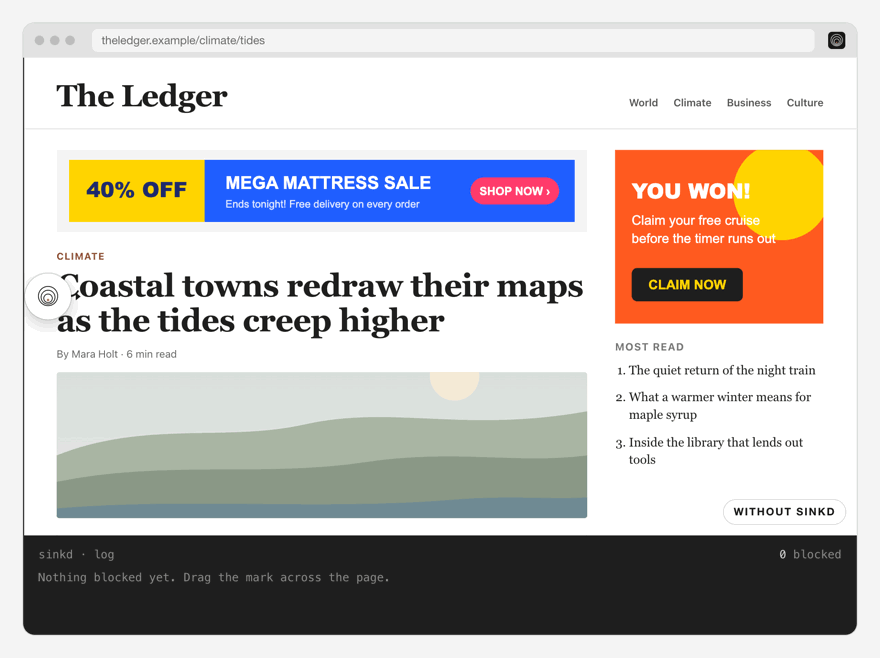
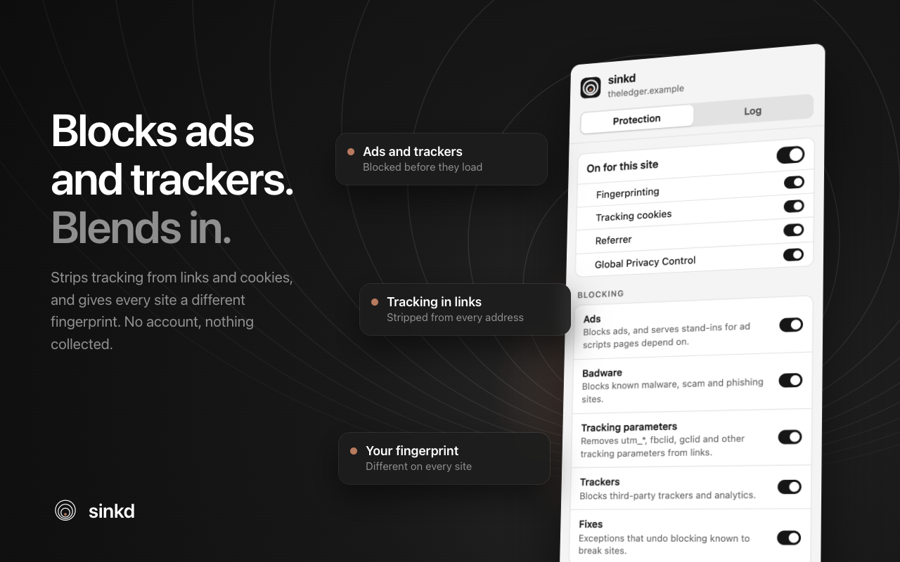
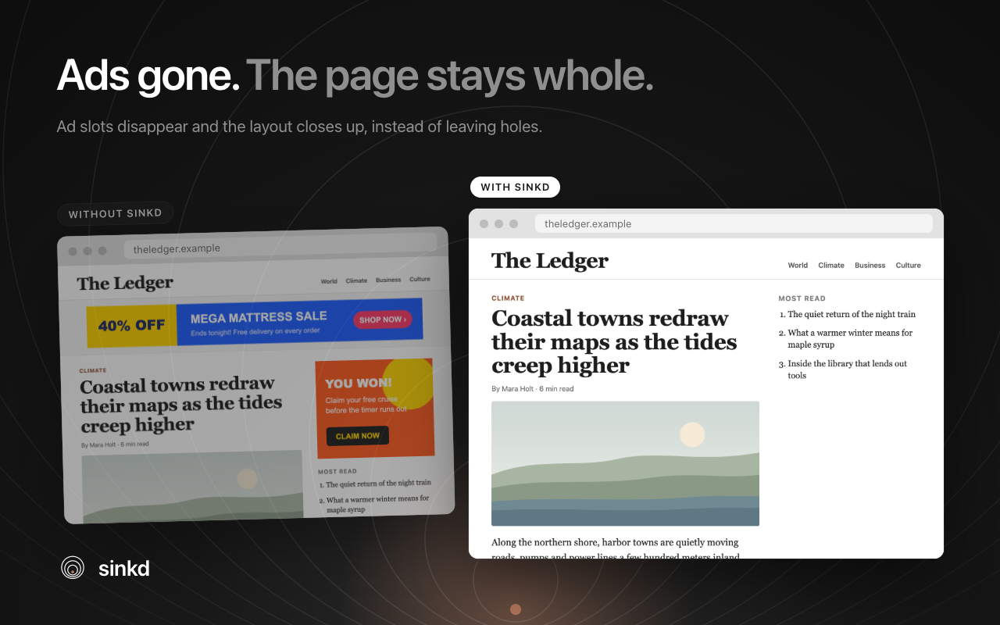
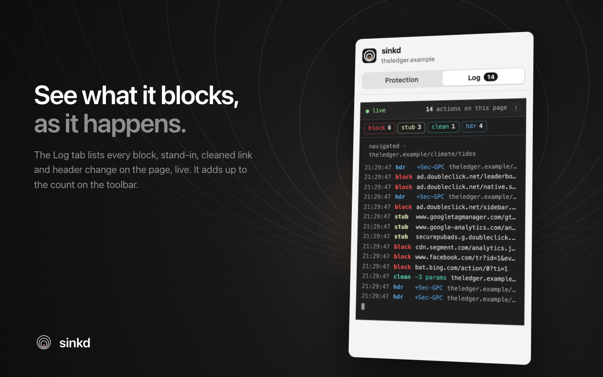
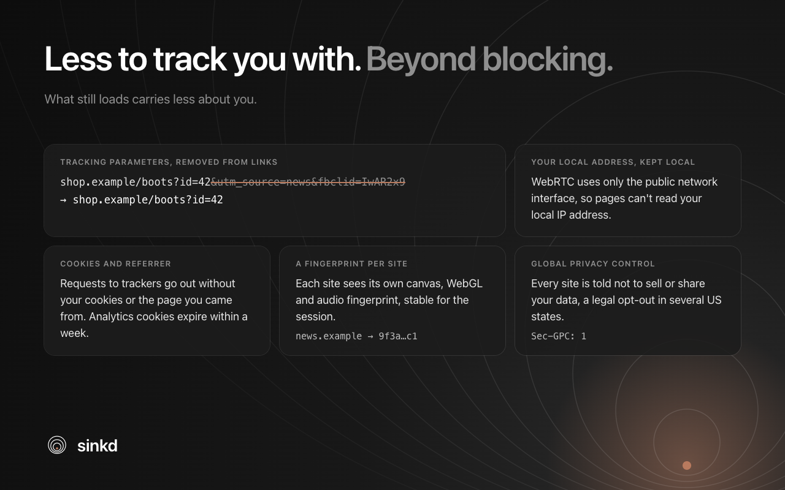
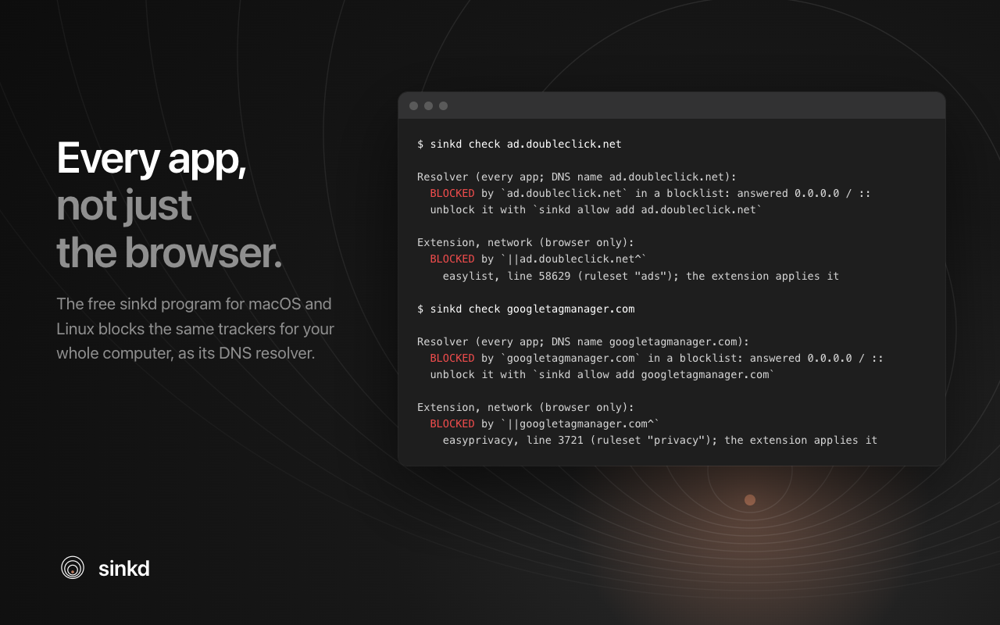
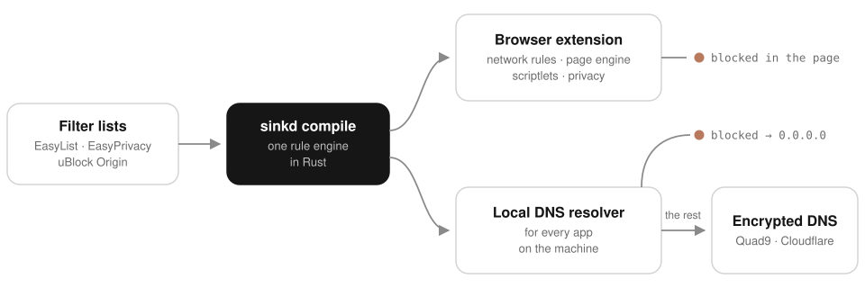

<p align="center">
  <picture>
    <source media="(prefers-color-scheme: dark)" srcset="docs/brand/graphite/wordmark.png">
    
  </picture>
</p>

<h3 align="center">Ad and tracker blocking that blends in.</h3>

<p align="center">
  One Rust rule engine, two layers: a browser extension for the page,<br>
  and a local DNS sinkhole for every other app on your computer.
</p>

<p align="center">
  <a href="https://chromewebstore.google.com/detail/abgodfdohgofhleaaenojdpjhapecknf"></a>
  &nbsp;
  <a href="#every-app-on-your-computer"></a>
</p>

<p align="center">
  <a href="https://chromewebstore.google.com/detail/abgodfdohgofhleaaenojdpjhapecknf"></a>
  
  
  
  <a href="#license"></a>
</p>

<p align="center">
  
</p>
<p align="center"><sub>Where sinkd has been, the ads are gone, the page closes up around them, and the log says what was blocked.</sub></p>

<p align="center">
  <b>If sinkd makes your web a little quieter, <a href="https://github.com/nald0422/sinkd/stargazers">give it a ⭐</a></b>: it's how other people find it.
</p>

---

## Why sinkd

<table>
  <tr>
    <td width="33%" valign="top">
      <h3>In your browser</h3>
      <p>Blocks ads, trackers and malware sites, hides the empty boxes they leave, strips tracking from links and cookies, and blurs your fingerprint. Chrome and Firefox, Manifest V3.</p>
    </td>
    <td width="33%" valign="top">
      <h3>In every app</h3>
      <p>A local DNS sinkhole answers ad and tracker names with <code>0.0.0.0</code> for every app on the machine, and sends the rest over encrypted DNS. One command installs it; one puts everything back.</p>
    </td>
    <td width="33%" valign="top">
      <h3>One set of rules</h3>
      <p>One compiler turns EasyList, EasyPrivacy and uBlock Origin's lists into both, so the browser and the resolver agree, and <code>sinkd check</code> tells you which rule decided.</p>
    </td>
  </tr>
</table>

### Why both layers

| | DNS blocker alone | Browser extension alone | **sinkd** |
|---|:---:|:---:|:---:|
| Blocks ads and trackers in every app, not just the browser | ✅ | — | ✅ |
| Hides leftover ad boxes and works around ad-blocker detection | — | ✅ | ✅ |
| Strips tracking parameters, tracker cookies and the referrer | — | ✅ | ✅ |
| One rule set for both, and one command that explains any block | — | — | ✅ |

## A closer look

<table>
  <tr>
    <td colspan="2"></td>
  </tr>
  <tr>
    <td colspan="2" align="center"><sub><b>Blocks ads and trackers. Blends in.</b> Switch it off for one site, or one protection, in a click.</sub></td>
  </tr>
  <tr>
    <td width="50%"></td>
    <td width="50%"></td>
  </tr>
  <tr>
    <td align="center"><sub><b>Ads gone. The page stays whole.</b> Ad slots disappear and the layout closes up, instead of leaving holes.</sub></td>
    <td align="center"><sub><b>See what it blocks, as it happens.</b> The Log tab lists every block, stand-in, cleaned link and header change.</sub></td>
  </tr>
  <tr>
    <td width="50%"></td>
    <td width="50%"></td>
  </tr>
  <tr>
    <td align="center"><sub><b>Less to track you with.</b> Clean links, no tracker cookies, a different fingerprint on every site.</sub></td>
    <td align="center"><sub><b>Every app, not just the browser.</b> <code>sinkd check</code> names the exact rule behind every block.</sub></td>
  </tr>
</table>

## What it does

**Blocking**
- Ads, trackers, and malware, scam and phishing sites, from EasyList, EasyPrivacy and uBlock Origin's lists.
- Harmless stand-ins for the ad and analytics scripts pages depend on, so pages keep working.
- Hides ad elements and runs the lists' scriptlets without leaving traces a page could detect.
- Closes the ad tabs pages pop open.
- Trackers hidden behind a site's own subdomain (CNAME uncloaking): in the resolver, and in Firefox.

**Privacy**
- Strips `utm_*`, `fbclid`, `gclid` and other tracking parameters from links.
- Keeps cookies and the referrer from trackers; analytics cookies expire within a week.
- A fingerprint per site: canvas, WebGL and audio noise, stable per site and session. It never spoofs your user agent, which would make you stand out.
- Sends Global Privacy Control, and keeps WebRTC from revealing your local IP address.

**Control**
- One switch per site, or per protection; or a kind of blocking off everywhere.
- In Chrome, a live log in the popup that adds up to the count on the toolbar badge.
- `sinkd check`, `pause`, `allow`, `block`, `stats` and `doctor` on the command line, and an optional bridge that passes them on to the browser.

**Built to be trusted**
- No account, no analytics, no remote code. Lists can only switch on scriptlets sinkd ships; they never bring code of their own.
- No HTTPS interception and no locally trusted root CA, ever.
- `#![forbid(unsafe_code)]` in every crate; the parsers, DNS handling and config are fuzzed.
- The store build can be reproduced from the source, byte for byte.
- `sudo sinkd uninstall` puts your DNS settings back exactly as they were.

## How it works

<p align="center">
  <picture>
    <source media="(prefers-color-scheme: dark)" srcset="docs/images/how-it-works-dark.svg">
    
  </picture>
</p>

## Get started

### In your browser

<a href="https://chromewebstore.google.com/detail/abgodfdohgofhleaaenojdpjhapecknf"></a>

Chrome 128 or newer. Firefox Add-ons is next; until then you can [build it and load it in Firefox](docs/development.md#build-the-extension) (Firefox 140 or newer).

### Every app on your computer

macOS or Linux with systemd, and Rust 1.88 or newer. Look at what it would change first:

```bash
git clone https://github.com/nald0422/sinkd && cd sinkd
cargo build --release -p sinkd-cli
./target/release/sinkd install --dry-run
```

Then, when you're ready:

```bash
sudo ./target/release/sinkd install
```

It runs as a service that never runs as root, points your DNS at it only once it answers, and checks that a blocked name now resolves to `0.0.0.0`. To undo all of it:

```bash
sudo sinkd uninstall
```

### Ask it anything

```text
$ sinkd check ad.doubleclick.net

Resolver (every app; DNS name ad.doubleclick.net):
  BLOCKED by `ad.doubleclick.net` in a blocklist: answered 0.0.0.0 / ::
  unblock it with `sinkd allow add ad.doubleclick.net`

Extension, network (browser only):
  BLOCKED by `||ad.doubleclick.net^`
    easylist, line 58629 (ruleset "ads"); the extension applies it
```

The [guide](docs/guide.md) covers the resolver, every command, the browser bridge, lists from the web, recovery, and what no blocker can do.

## Help sinkd grow

- **Star the repo.** It's the simplest way to help: stars are how people find projects like this.
- **Tell someone** who's tired of ads and trackers following them around.
- **Found a site sinkd breaks?** [Open an issue](https://github.com/nald0422/sinkd/issues/new) with the address and what went wrong.
- **Want to hack on it?** [docs/development.md](docs/development.md) has the layout, the builds and the tests.

## Documentation

- **[Using sinkd](docs/guide.md)**: the resolver, installing and uninstalling, the command line, the browser bridge, lists, recovery, and what it can't do.
- **[Developing sinkd](docs/development.md)**: the layout, and building and testing the crates, the extension and the website.
- **[Design notes](DESIGN.md)**: the decisions behind sinkd, with measurements.
- **[Privacy policy](docs/privacy.md)**: what sinkd sees and stores, and that it collects nothing about you.
- **[Breakage checklist](docs/breakage-checklist.md)**: checking sites by hand after a change.

## License

Licensed under either of [Apache License, Version 2.0](LICENSE-APACHE) or
[MIT license](LICENSE-MIT) at your option.

Scriptlets and surrogates are original implementations. No code is taken from
uBlock Origin, AdGuard or Brave, whose resources are GPLv3. Brave's `adblock`
crate (MPL-2.0) is used only as a test oracle and is never shipped.

The extension's compiled rules are not sinkd's own: they are translated from
EasyList, EasyPrivacy and uBlock Origin's lists and are distributed under the
GNU GPL, version 3 (see `NOTICES.txt` in a build).
